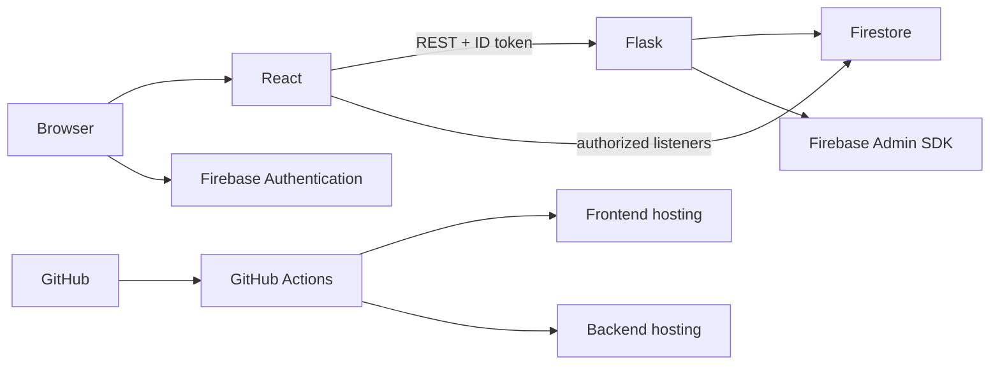
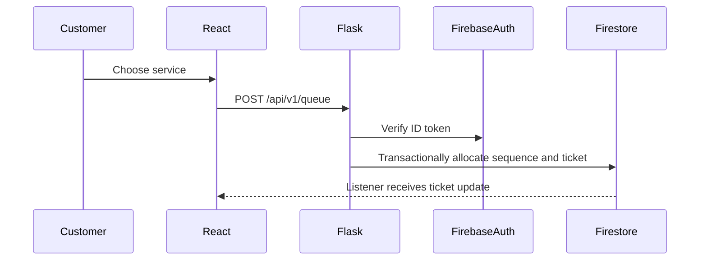

# Architecture

React handles presentation. Flask is the authoritative queue API. Firebase Authentication verifies identity. Firestore stores tickets and allows authorized real-time reads. Firebase Security Rules add direct-browser protection. The Admin SDK is only used server-side.

## Joining flow

