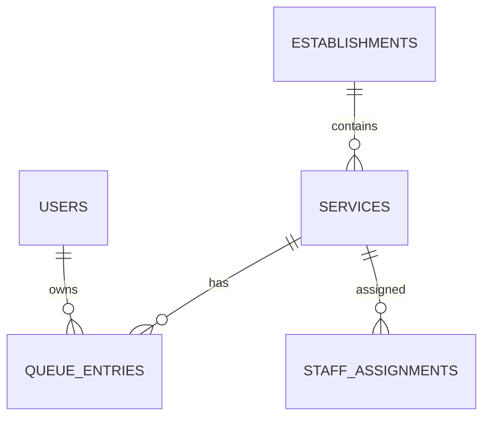

# Database Design

## Collections

- `users/{uid}` — profile, server-controlled role, and account status. UID matches Firebase Authentication.
- `establishments/{id}` — physical or virtual service location.
- `services/{id}` — establishment, pause state, capacity, and service duration estimate.
- `queueEntries/{ticketId}` — ticket owner, sequence, status, timestamps, and optimistic version.
- `queueCounters/{serviceId}` — last allocated sequence, allocated transactionally.
- `staffAssignments/{assignmentId}` — staff-to-service authorization.

Statuses are WAITING, CALLED, SERVING, COMPLETED, CANCELLED, and NO_SHOW. Indexes in `firebase/firestore.indexes.json` support service/status/sequence queries and customer history.
