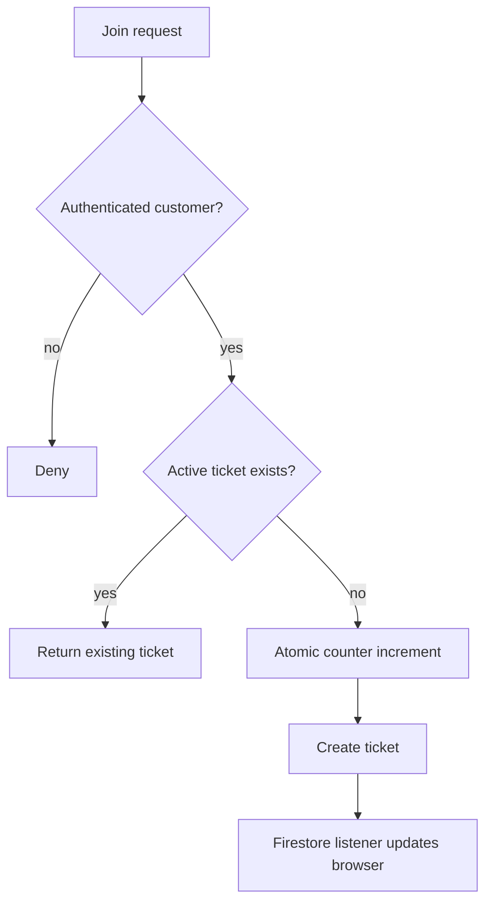

# Queue Algorithms

Joining:

1. Verify the user and service.
2. Reject a second active ticket for the same service.
3. Increment the service counter atomically.
4. Create one persisted ticket with the resulting sequence.
5. Repeated requests return the existing ticket.

The deterministic ordering rule is ascending `queueSequence`. Position is the count of earlier WAITING or CALLED tickets plus one. Estimated wait is the number of earlier active tickets times the service's configured duration.

Staff transitions follow WAITING → CALLED → SERVING → COMPLETED. WAITING and CALLED may become CANCELLED; CALLED may become NO_SHOW. Production Firestore uses a transaction to allocate sequences; equal concurrent allocation is serialized by Firestore. Transaction delivery and browser timing are not guaranteed to be instantaneous.
